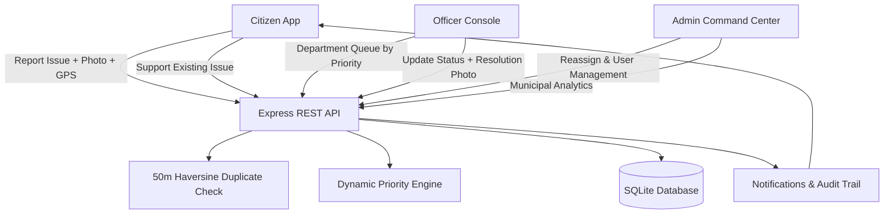

# CityPulse

> Real-time urban problem reporting, automated municipal department routing, duplicate prevention, and civic resolution management platform.

---

## 📌 Problem Statement
Citizens encounter road potholes, defunct streetlights, overflowing garbage, water leakages, and traffic congestion without visibility into civic resolution. Existing municipal complaint portals suffer from:
1. **Duplicate complaint bloat**: Multiple citizens filing separate tickets for the same physical issue.
2. **Incorrect department routing**: Inefficient manual triage causing delayed dispatch.
3. **Lack of status updates**: Citizens left in the dark without resolution proof or audit trails.

**CityPulse** solves this by combining a reactive Flutter mobile/web client with a Node.js/SQLite backend: 50-meter Haversine duplicate prevention, automatic departmental routing with base urgency weights, dynamic community-backed prioritization, and full lifecycle photo verification.

---

## ✨ Features by Role

### 1. 👤 Citizen
- **Registration & Authentication**: Secure JWT-based registration and login with local session persistence.
- **Problem Reporting**: Category selection, description, on-site camera capture or gallery upload (`image_picker`), and interactive GPS coordinates picker.
- **Duplicate Detection**: 50-meter Haversine radius matching on open issues within the same category. Prompts with a 1-click **"Support It"** action or `force=true` bypass.
- **Live City Map & List Views**: Switch between a vector city grid with radar pulse pins and responsive complaint cards.
- **Community Support (+1)**: Boost existing community complaints to elevate their priority score.
- **Audit Trail & Tracking**: Chronological status timeline (`ASSIGNED` $\to$ `IN_PROGRESS` $\to$ `RESOLVED`) with resolution photo proof.
- **Notification Center**: Real-time alerts on status updates and department assignments.

### 2. 🛠️ Municipal Officer
- **Department-Scoped Workspace**: Officers are designated to specific municipal branches (*Roads*, *Electricity*, *Sanitation*, *Water*, *Traffic*).
- **Priority-Sorted Queue**: Workload is strictly ordered by dynamic priority score so critical hazards are addressed first.
- **Status Lifecycle Updates**: Transition issues from `ASSIGNED` $\to$ `IN_PROGRESS` $\to$ `RESOLVED`.
- **Resolution Proof Upload**: Capture and upload after-fix photo evidence and field inspection remarks.

### 3. 🛡️ City Administrator
- **Municipal Analytics Command Center**: Real-time KPI metrics:
  - Total Complaints & Resolution Rate (%)
  - Average Resolution Time (in hours)
  - Workload distribution across municipal departments
  - Breakdown by problem category and status lifecycle
- **Complaint Triage & Reassignment**: Reallocate complaints across departments or assign individual field officers.
- **User Management**: Inspect registered citizens, field officers, and administrators; reassign roles and department assignments.

---

## 🛠️ Tech Stack
- **Frontend**: Flutter 3.x, Dart, Provider (State Management), `http`, `image_picker`, `intl`, `shared_preferences`.
- **Backend**: Node.js, Express.js, SQLite (`better-sqlite3`), JWT Authentication (`jsonwebtoken`), `bcryptjs`, `multer` (multipart uploads), CORS.
- **Algorithms**:
  - **Duplicate Detection**: Haversine distance formula ($\le 50\text{m}$ radius).
  - **Dynamic Prioritization Engine**:
    $$\text{score} = \text{base\_priority} + \min(\text{support\_count}, 10) + (0.5 \times \text{days\_open})$$
    - Base Priority: *Water Leakage* (3), *Pothole* (2), *Streetlight* (2), *Traffic* (2), *Garbage* (1)
    - Classification: `HIGH` ($\ge 10$), `MEDIUM` ($\ge 5$), `LOW` ($< 5$)

---

## 🏛️ Architecture Overview



---

## 🚀 Setup & Running on Windows

### Prerequisites
- Node.js (v18+ or v20+ LTS) and npm
- Flutter SDK (v3.13+)

### 1. Backend Setup
```powershell
cd backend
npm install
npm run seed     # Seeds admin, department officers, citizens, and sample issues
npm start        # Launches API and static web bundle on http://localhost:3000
```
*Run automated backend tests:*
```powershell
npm test         # Executes end-to-end integration test suite
```

### 2. Frontend Setup
```powershell
cd frontend
flutter pub get

# Run on Google Chrome (Web)
flutter run -d chrome

# Or run as Windows Desktop application
flutter run -d windows
```

---

## 🔑 Demo Credentials (1-Click Login in App)

| Role | Email | Password | Department / Scope |
| :--- | :--- | :--- | :--- |
| **Citizen (Alice)** | `citizen.alice@example.com` | `CitizenPassword123!` | Public reporting & community voting |
| **Officer (Roads)** | `officer.roads@citypulse.gov` | `OfficerPassword123!` | Roads Department issue triage |
| **Officer (Water)** | `officer.water@citypulse.gov` | `OfficerPassword123!` | Water Department issue triage |
| **City Administrator** | `admin@citypulse.gov` | `AdminPassword123!` | Citywide Analytics & Reassignment |

---

## 🔮 Future Improvements
1. **Offline-First Sync**: Local SQLite sync for offline complaint draft submissions in low-connectivity areas.
2. **AI Computer Vision**: Automated image classification using Gemini Vision to auto-detect category and severity from photos.
3. **IoT Sensor Ingestion**: Real-time integration with smart water pressure monitors and connected streetlights.
4. **Push Notifications**: Firebase Cloud Messaging (FCM) integration for background push alerts.
5. **Multi-lingual Voice Reporting**: Voice-to-text reporting in regional languages for accessibility.

---

## 📄 License
This project is licensed under the [MIT License](LICENSE).
